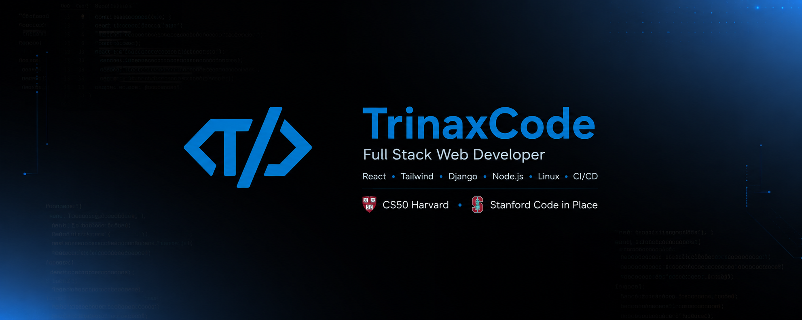

  

<h1 align="center">Hi, I'm TrinaxCode</h1>
<h3 align="center">Full-stack product engineer · Local-first AI · Open source</h3>

  <a href="https://trinaxai.app">Website</a> ·
  <a href="https://github.com/TrinaxCode">GitHub</a> ·
  <a href="https://www.linkedin.com/in/trinaxcode/">LinkedIn</a> ·
  <a href="mailto:trinaxcode@gmail.com">Email</a>

I'm a Nicaraguan developer based in Tuxtla Gutiérrez, Mexico. I build complete products—from accessible interfaces and business workflows to APIs, security boundaries, tests, CI, and deployment. My current focus is private, local-first AI that gives users control of their data.

I care about software that works outside a demo: real users, clear trade-offs, safe defaults, and maintainable systems.

## What I'm shipping now

### [TrinaxAI](https://github.com/TrinaxCode/TrinaxAI) · [trinaxai.app](https://trinaxai.app)

An open-source, local-first AI assistant built around Ollama. It combines a FastAPI backend, React/TypeScript PWA, developer CLI, and a RAG engine for private files and code.

- Hybrid vector + BM25 retrieval, cited answers, collections, reranking, and multi-pass research
- Sandboxed coding agent with workspace confinement and approval for dangerous actions
- Scoped, revocable device pairing for private features across a local network
- Local memory, voice, vision, attachments, web search, and cross-device synchronization
- Linux, macOS, and Windows installers; CI across all three platforms
- Python and frontend tests, Ruff, CodeQL, release automation, and reproducible release assets

`Python` `FastAPI` `React` `TypeScript` `Ollama` `RAG` `PWA` `GitHub Actions`

## Selected production work

| Project | What I delivered | Stack |
|---|---|---|
| [Belcons Remodeling](https://belconsremodeling.com/) | Full-stack platform for a US remodeling business: lead capture, project and quote management, private admin workflows, media delivery, and SEO. | Django · PostgreSQL · Cloudinary |
| [Rednura Web](https://rednura.web.app/) | Static commerce platform with 42 products, cart and wishlist, WhatsApp checkout, and a rule-based recommendation assistant covering 139 health conditions. | HTML · CSS · JavaScript · Firebase |
| [CEDAS Montessori](https://davidalfarosiqueiros.web.app/) | Responsive school website with TypeScript, build-time prerendering, structured data, optimized media, and enrollment-focused UX. | React · TypeScript · Tailwind · Firebase |
| [Iglesia El Jobo](https://adventistaseljobo.web.app/) | Community portal with crawlable content, events, gallery, location, social channels, structured data, and optimized media. | React · JavaScript · Tailwind · Firebase |

## More engineering work

- **TrinaxBank** — bilingual banking application with Next.js, TypeScript, Prisma, and NextAuth. I implemented cent-normalized money operations, atomic balance guards, Zod validation, rate limiting, anti-enumeration login behavior, analytics, recurring transfers, and unit/integration/E2E tests.
- **ApexLumen** — Django educational platform with authentication, contributions, search, saves, likes, ratings, comments, permissions, pagination, and image/video/PDF handling.
- **Facial Expression Detector** — real-time webcam application using Python, OpenCV, and MediaPipe, with configurable heuristics and temporal smoothing.

## How I engineer

| Area | Practices I use |
|---|---|
| Product | End-to-end ownership, bilingual UX, responsive interfaces, progressive enhancement |
| Backend | FastAPI, Django, Next.js server actions, REST APIs, validation, authorization |
| Data | PostgreSQL, SQLite, Prisma, Django ORM, Firestore, hybrid search |
| Reliability | Pytest, Vitest, Testing Library, Playwright, CI, cross-platform checks |
| Security | Least privilege, scoped capabilities, sandboxing, rate limits, safe cookies, CodeQL |
| Delivery | Linux, Git, GitHub Actions, Firebase, Cloudflare, Railway, Heroku, Cloudinary |

## Education

| Program | Status | Certificate |
|---|---|---|
| HarvardX CS50x — Introduction to Computer Science | Completed | — |
| HarvardX CS50W — Web Programming with Python and JavaScript | Completed |   |
| Stanford Code in Place 2026 | Completed |  |

## Beyond code

I share what I learn and build through [TikTok](https://www.tiktok.com/@trinaxcode), [Instagram](https://www.instagram.com/trinaxcode/), [X](https://x.com/TrinaxCode), and [Facebook](https://www.facebook.com/TrinaxCode). I am open to remote roles, open-source collaboration, and product work with real-world impact.

  <strong>Build it clearly. Test the risky parts. Ship what people need.</strong>

