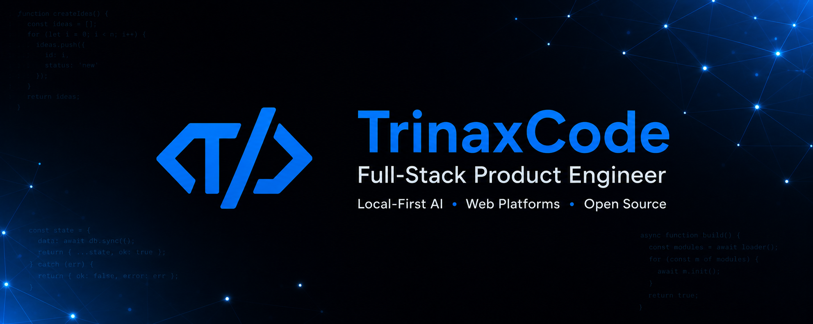
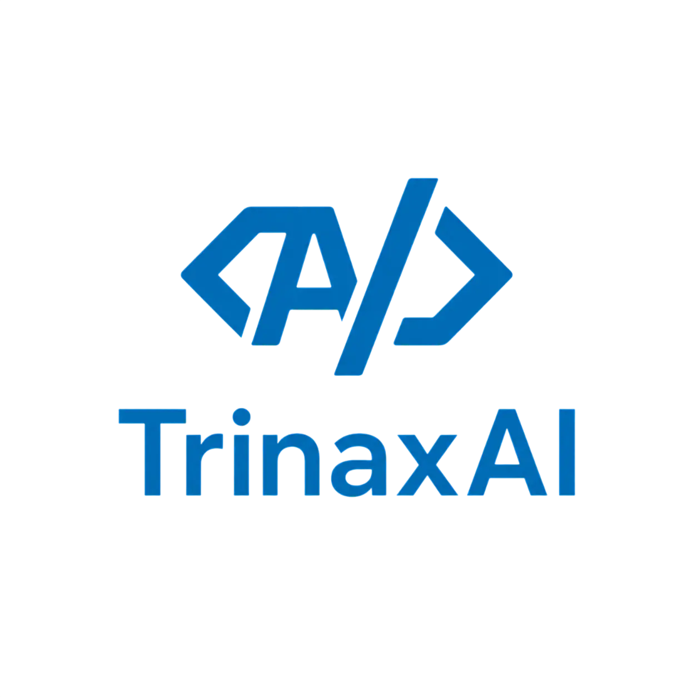
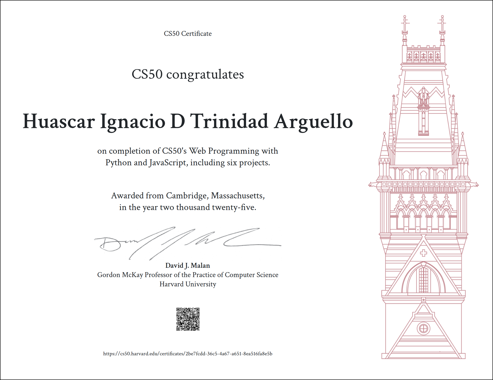
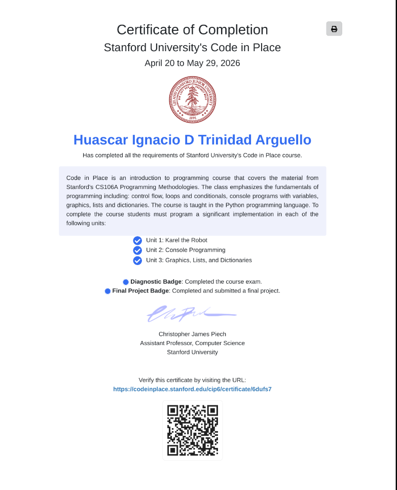

<p align="center">
  
</p>

<p align="center">
  <a href="https://git.io/typing-svg">
    
  </a>
</p>

<p align="center">
  <a href="https://github.com/TrinaxCode"></a>
  <a href="https://www.linkedin.com/in/trinaxcode/"></a>
  <a href="mailto:trinaxcode@gmail.com"></a>
</p>

<p align="center">
  🇳🇮 Nicaraguan developer &nbsp;·&nbsp; 📍 Based in Managua, Nicaragua &nbsp;·&nbsp; 🌎 Open to remote opportunities
</p>

## `$ whoami`

I'm a self-taught engineer who grew from building static pages to shipping complete products with authentication, data, security, testing, CI, and cross-platform delivery.

I work across the stack, but my favorite problems live where **product thinking, backend engineering, and applied AI** meet. I care about privacy, useful software, safe defaults, and owning the full path from an idea to something people can actually use.

```yaml
current_focus:  "Local-first AI, RAG, developer tools, full-stack products"
building:       "TrinaxAI"
working_style:  "Understand deeply · Build simply · Test the risky parts · Ship"
languages:      "Spanish (native) · English (C2, EF SET 72/100)"
```

## 🚀 Flagship project

<p align="center">
  <a href="https://github.com/TrinaxCode/TrinaxAI">
    
  </a>
</p>

<h3 align="center">
  <a href="https://github.com/TrinaxCode/TrinaxAI">TrinaxAI</a> ·
  <a href="https://trinaxai.app">Product site</a>
</h3>

<p align="center">
  <a href="https://github.com/TrinaxCode/TrinaxAI/releases"></a>
  <a href="https://github.com/TrinaxCode/TrinaxAI/actions/workflows/ci.yml"></a>
  <a href="https://github.com/TrinaxCode/TrinaxAI/actions/workflows/codeql.yml"></a>
  <a href="https://github.com/TrinaxCode/TrinaxAI/stargazers"></a>
  <a href="https://github.com/TrinaxCode/TrinaxAI/blob/main/LICENSE"></a>
</p>

**TrinaxAI is an open-source, local-first AI assistant that keeps inference and user data on their own hardware by default.** It combines a FastAPI backend, React/TypeScript PWA, developer CLI, and a RAG engine for private files and code.

- Hybrid vector + BM25 retrieval, reranking, cited answers, collections, and multi-pass research
- Sandboxed coding agent with workspace confinement and approvals for dangerous actions
- Scoped and revocable device pairing for private features across a local network
- Local memory, voice, vision, attachments, optional web search, and cross-device sync
- Installers and CI for Linux, macOS, and Windows, plus automated releases and CodeQL
- 90+ Python/frontend test files covering the agent, CLI, RAG, security, pairing, state, and services

<p align="center">
  <a href="https://github.com/TrinaxCode/TrinaxAI"><strong>Explore the source →</strong></a>
</p>

## 🧩 Selected products

| Product | Problem solved | Engineering |
|---|---|---|
| 🏠 **[Belcons Remodeling](https://belconsremodeling.com/)** | Lead capture, project presentation, quote management, and private workflows for a US remodeling company. | Django · PostgreSQL · Cloudinary · SSR |
| 🌿 **[Rednura Web](https://rednura.web.app/)** | Product discovery and WhatsApp commerce with 42 products and rule-based guidance for 139 health conditions. | JavaScript · Firebase · Local storage · Structured data |
| 🎓 **[CEDAS Montessori](https://davidalfarosiqueiros.web.app/)** | Enrollment-focused digital presence for a Montessori school, with fast crawlable content and optimized media. | React · TypeScript · Prerendering · Firebase |
| ⛪ **[Iglesia El Jobo](https://adventistaseljobo.web.app/)** | Accessible community information, events, media, location, and contact channels. | React · Tailwind · Firebase · SEO |

### Engineering beyond the live sites

- **TrinaxBank** — bilingual Next.js banking application with cent-normalized money operations, atomic balance guards, Prisma transactions, NextAuth, Zod validation, rate limiting, analytics, recurring transfers, and unit/integration/E2E tests.
- **ApexLumen** — Django educational platform with authentication, contributions, search, permissions, saves, likes, ratings, comments, pagination, and multi-format media handling.
- **Facial Expression Detector** — real-time Python/OpenCV/MediaPipe application using configurable facial heuristics and temporal smoothing.

## 🛠️ Toolbox

<p align="center">
  
</p>

<p align="center">
  <sub>Python · TypeScript · JavaScript · React · Next.js · FastAPI · Django · PostgreSQL · Prisma · Tailwind · Firebase · Docker · Linux · Git · GitHub Actions</sub>
</p>

| I build | I protect | I verify |
|---|---|---|
| APIs, PWAs, SSR sites, CLIs, RAG systems | Authentication, authorization, least privilege, sandboxing, rate limits | Pytest, Vitest, Testing Library, Playwright, CI, CodeQL |

## 📈 The journey

```text
2022  ── HTML, CSS, JavaScript fundamentals
2023  ── Learning by building small web experiences
2024  ── Python and deeper programming foundations
2025  ── Django applications, authentication, databases, and CS50W
2026  ── Production platforms, computer vision, secure systems, and TrinaxAI v1.0
```

The constant has been simple: every project should teach me something the previous one could not.

## 🎓 Education

| Program | Evidence |
|---|---|
| **Harvard CS50W** — Web Programming with Python and JavaScript | [CS50 certificate](https://cs50.harvard.edu/certificates/2be7fcdd-36c5-4a67-a651-8ea516fa8e5b) · [edX verified certificate](https://courses.edx.org/certificates/9e05af2e3b584f4bbda94476979aaaeb) |
| **Harvard CS50x** — Introduction to Computer Science | Completed coursework and problem sets |
| **Stanford Code in Place 2026** | [Verified certificate](https://codeinplace.stanford.edu/cip6/certificate/6dufs7) |

<p align="center">
  <a href="https://cs50.harvard.edu/certificates/2be7fcdd-36c5-4a67-a651-8ea516fa8e5b"></a>
  &nbsp;
  <a href="https://courses.edx.org/certificates/9e05af2e3b584f4bbda94476979aaaeb"></a>
</p>

<p align="center">
  <a href="https://codeinplace.stanford.edu/cip6/certificate/6dufs7"></a>
</p>

## 🤝 Let's build something useful

I'm open to remote engineering roles, open-source collaboration, and product work where reliability and real-world impact matter.

<p align="center">
  <a href="mailto:trinaxcode@gmail.com"></a>
</p>

<p align="center">
  <a href="https://www.tiktok.com/@trinaxcode">TikTok</a> ·
  <a href="https://www.instagram.com/trinaxcode/">Instagram</a> ·
  <a href="https://x.com/TrinaxCode">X</a> ·
  <a href="https://www.facebook.com/TrinaxCode">Facebook</a> ·
  <a href="https://orcid.org/0009-0009-2321-9834">ORCID</a>
</p>

<p align="center">
  <strong>Understand deeply. Build simply. Ship what matters.</strong>
</p>
