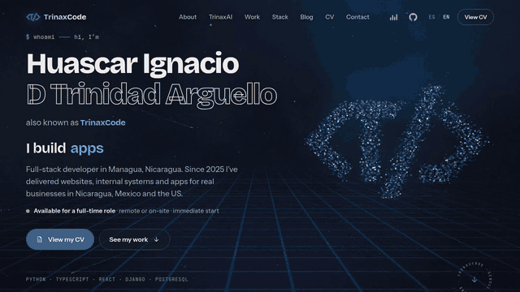
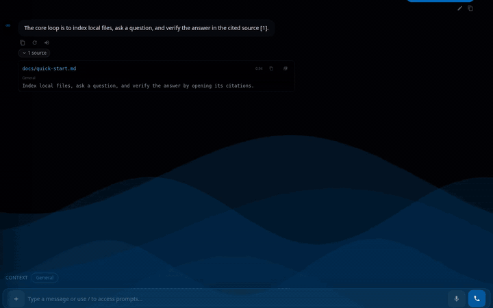
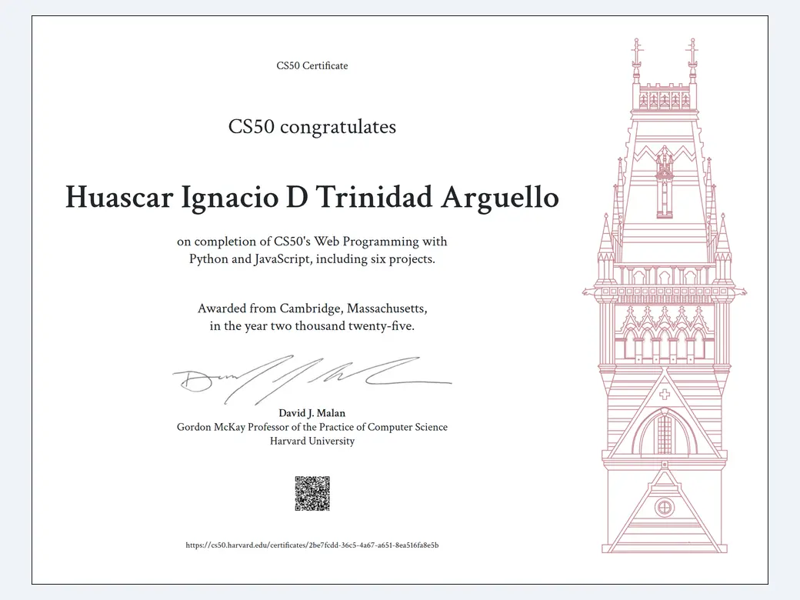
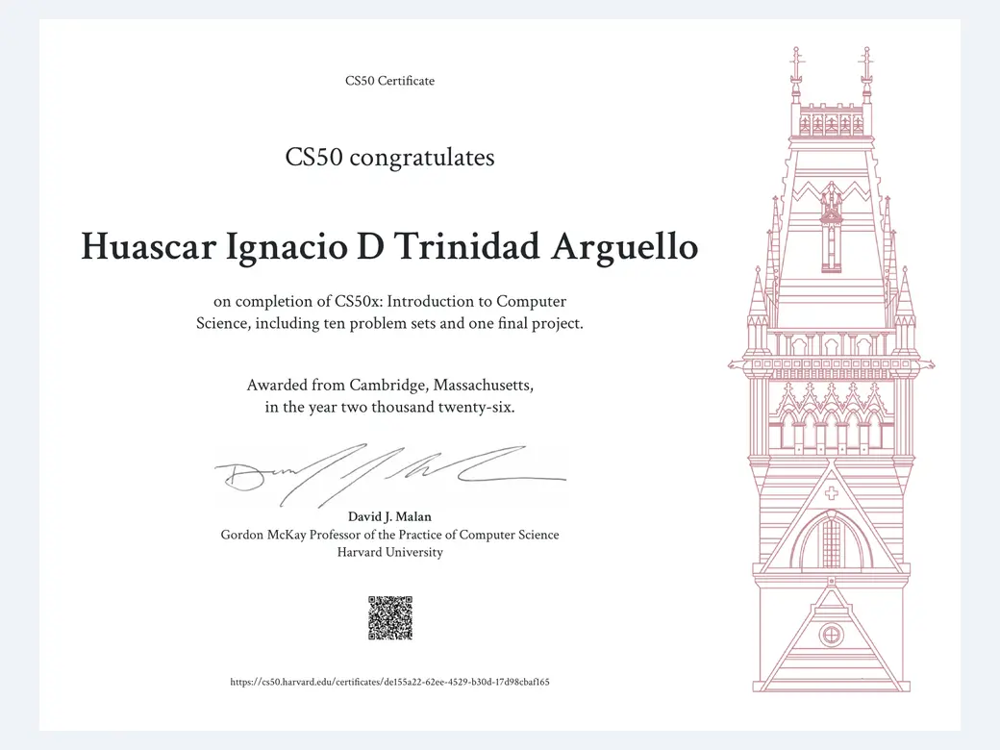
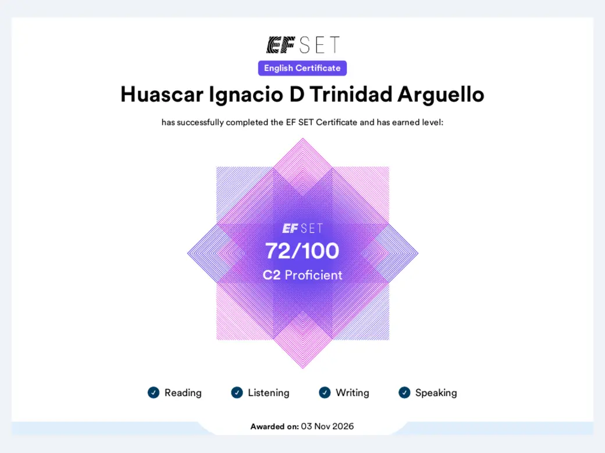

<p align="center">
  
</p>

<p align="center">
  <a href="https://git.io/typing-svg">
    
  </a>
</p>

<p align="center">
  <a href="https://trinaxcode.com"></a>
  <a href="https://www.linkedin.com/in/trinaxcode/"></a>
  <a href="mailto:hola@trinaxcode.com"></a>
</p>

<p align="center">
  🇳🇮 Nicaraguan developer &nbsp;·&nbsp; 📍 Managua, Nicaragua (UTC−6) &nbsp;·&nbsp; 🟢 Available for a full-time role, remote or on-site
</p>

<details>
<summary><strong>Resumen en español</strong></summary>

<br>

Soy **Huascar Ignacio D Trinidad Arguello**, desarrollador full-stack autodidacta de Managua, Nicaragua. Desde 2025 he entregado sitios web, sistemas internos y apps para negocios reales en Nicaragua, México y Estados Unidos, y construyo mis propias herramientas de código abierto: **[TrinaxAI](https://github.com/TrinaxCode/TrinaxAI)** (un asistente de IA local que cita tus archivos) y **[MirrorLab](https://github.com/TrinaxCode/mirrorlab)** (una cámara virtual controlada con gestos de la mano).

Busco un puesto de **tiempo completo**, remoto o presencial, con inicio inmediato, y sigo aceptando proyectos freelance. Todo mi trabajo, con demos y CV en español e inglés, está en **[trinaxcode.com](https://trinaxcode.com)**. Escríbeme a [hola@trinaxcode.com](mailto:hola@trinaxcode.com).

</details>

## `$ whoami`

I'm **Huascar Ignacio D Trinidad Arguello**, a self-taught full-stack developer who went from gift pages for family and friends to shipping real products: websites, internal systems and apps for businesses in Nicaragua, Mexico and the United States, plus my own open-source tools.

I don't only write the code. I talk with the client, learn how the business actually runs, and stay until it works. At Comedor Doña Chola that meant setting up the waiter tablets and kitchen printers and writing the cashier guides for the staff.

My favorite problems live where **product thinking, backend engineering, and applied AI** meet. I care about privacy, safe defaults, and owning the whole path from an idea to something people actually use.

```yaml
current_focus:  "Local-first AI, full-stack web, developer tools"
building:       "TrinaxAI · MirrorLab · ContaNI"
working_style:  "Spec → plan → tests → review → ship (AI agents help, they don't decide)"
languages:      "Spanish (native) · English (C2, EF SET 72/100)"
availability:   "Full-time, remote or on-site, immediate start · freelance projects welcome"
```

## 🌐 My portfolio is live

<p align="center">
  <a href="https://trinaxcode.com">
    
  </a>
</p>

**[trinaxcode.com](https://trinaxcode.com)** is where everything below lives with live demos, tech stacks and the story behind each project.

- 12 projects (client work and my own), each with its stack and a live link or source
- Bilingual (Spanish / English), with the [CV](https://trinaxcode.com/cv/) to read online or download as PDF
- Verifiable certificates, an FAQ, a blog for case studies (the first ones are in the works), and a [15-minute call booking](https://cal.com/trinax-code-xst3w0/primera-llamada)

## 🚀 Flagship project

<p align="center">
  <a href="https://github.com/TrinaxCode/TrinaxAI">
    
  </a>
</p>

<h3 align="center">
  <a href="https://github.com/TrinaxCode/TrinaxAI">TrinaxAI</a> ·
  <a href="https://trinaxai.app">Product site</a> ·
  <a href="https://github.com/TrinaxCode/TrinaxAI/releases">Releases</a>
</h3>

<p align="center">
  <a href="https://github.com/TrinaxCode/TrinaxAI/releases"></a>
  <a href="https://www.npmjs.com/package/trinaxai"></a>
  <a href="https://github.com/TrinaxCode/TrinaxAI/actions/workflows/ci.yml"></a>
  <a href="https://github.com/TrinaxCode/TrinaxAI/actions/workflows/codeql.yml"></a>
  <a href="https://github.com/TrinaxCode/TrinaxAI/stargazers"></a>
  <a href="https://github.com/TrinaxCode/TrinaxAI/blob/main/LICENSE"></a>
</p>

**TrinaxAI is an open-source AI assistant that runs on your own computer and keeps inference and indexed data on your hardware by default.** You ask about your documents and code, and it answers with a citation to the file it used. It combines a FastAPI backend, a React/TypeScript PWA, a terminal CLI, and a RAG engine for private files and code.

```bash
npm install -g trinaxai@latest
trinaxai setup
```

<p align="center">
  
  <br>
  <sub>Cited answers · indexing · agent approvals · device pairing (tour from <a href="https://trinaxai.app">trinaxai.app</a>)</sub>
</p>

- Cited answers over your files with hybrid retrieval, collections and incremental indexing, plus optional web research, memory, voice and vision
- Local models through Ollama, with a profile chosen automatically from your RAM and GPU
- A coding agent confined to approved workspaces, with approvals for risky actions and a networkless sandbox for its terminal tool on Linux
- Scoped, revocable device pairing so other devices on your network only get the capabilities you grant
- Official installer on npm that verifies SHA-256 checksums; releases, CI and CodeQL for Linux, macOS and Windows
- 200+ Python and frontend test files covering the agent, CLI, RAG, security, pairing and services
- Honest documentation: its README lists known limits, such as which platforms are covered by CI but not yet by end-to-end runs

<p align="center">
  <a href="https://github.com/TrinaxCode/TrinaxAI"><strong>Explore the source →</strong></a>
</p>

## 🪞 MirrorLab

**A virtual camera for video calls, driven by your hands.** Blurs or replaces your background, keeps you in frame, meters the light on your face, and covers the camera with a gesture. It shows up as a camera in Zoom, Meet, Teams, Discord and OBS. Desktop app for Windows, macOS and Linux, CPU only, nothing leaves your machine.

<p align="center">
  
</p>

<p align="center">
  <a href="https://github.com/TrinaxCode/mirrorlab/releases/latest"></a>
  <a href="https://github.com/TrinaxCode/mirrorlab/actions/workflows/ci.yml"></a>
  <a href="https://github.com/TrinaxCode/mirrorlab/blob/main/LICENSE"></a>
  
</p>

- Hold-to-confirm hand gestures for the privacy shutter, reactions and background switching, plus a local `ctl` command you can bind to any hotkey
- Fails closed: if the person mask is unavailable the whole frame is blurred, and a closed shutter never shows camera pixels
- About 30 fps at 720p on a laptop CPU, measured and documented in the repository
- Installers for Windows, macOS (Apple silicon) and Linux, each release with `SHA256SUMS` and build provenance
- Limits written down up front: it needs OBS on Windows and macOS, and the macOS build is not notarized yet

<p align="center">
  <a href="https://mirrorlabapp.web.app/en/"><strong>Website</strong></a> ·
  <a href="https://github.com/TrinaxCode/mirrorlab"><strong>Source →</strong></a>
</p>

## 🧩 Selected products

| Product | Problem solved | Engineering |
|---|---|---|
| 🏠 **[Belcons Remodeling](https://belconsremodeling-production.up.railway.app/)** | Lead capture, project presentation and quote management for a remodeling company in Florida, USA, with a private admin panel. | Django · PostgreSQL · Cloudinary · Railway |
| 📒 **[ContaNI](https://conta-ni.web.app/)** | Accounting for small businesses in Nicaragua: journal, ledger, VAT (IVA), bank reconciliation and month-end close. Try it without creating an account. | Next.js · TypeScript · Supabase · Clerk · 890+ unit tests |
| ☕ **[Shine Coffee](https://shine-coffee.vercel.app/)** | Online coffee store in córdobas with PayPal checkout, order tracking and a role-based admin panel. | JavaScript · Node · Firebase · Vercel |
| 🍽️ **Comedor Doña Chola** *(private)* | Point of sale for a 12-table restaurant: waiter tablets, cashier and kitchen tickets on thermal printers. I installed 4 tablets and 4 printers and wrote the staff guides. | React · TypeScript · Supabase |
| 🎓 **[CEDAS Montessori](https://davidalfarosiqueiros.web.app/)** | Enrollment-focused website for a school: contact form, FAQ search and prerendered pages for Google. | React · TypeScript · Firebase |
| ⛪ **[Iglesia El Jobo](https://adventistaseljobo.web.app/)** | Accessible community site with events, gallery and contact, tested on phone, tablet and desktop. | React · Tailwind · Playwright |
| 🌿 **[Rednura](https://rednura.web.app/)** | 42-product catalog with guides for 139 health conditions, a cart and ordering through WhatsApp. | JavaScript · Firebase · Structured data |
| 🧪 **[Neotonic](https://neotonic.mx/)** | Company landing page with SEO, security headers and a build step that validates the structured data. | HTML · CSS · Firebase · JSON-LD |
| 📊 **El Rincón de los Antojitos** *(private)* | Finance dashboard for a food business: daily sales, costs, expenses, profit and accounts receivable. | React · Firebase |

### Engineering beyond the live sites

- **[TrinaxBank](https://github.com/TrinaxCode/TrinaxBank)** ([live demo](https://trinaxbank.vercel.app/)) — an educational, bilingual banking simulation with Next.js, Prisma and NextAuth. Money is stored in integer cents, balance updates are guarded and atomic, transfers carry idempotency keys so they can't run twice, large transfers ask for step-up verification, and the repo has 240+ unit/integration tests plus 24 Playwright and accessibility tests. MIT licensed, synthetic data only.
- **ApexLumen** — Django educational platform with authentication, contributions, search, permissions, likes, ratings, comments and multi-format media.

## 🛠️ Toolbox

<p align="center">
  
</p>

<p align="center">
  <sub>Python · TypeScript · JavaScript · React · Next.js · Tailwind · Django · Node.js · PostgreSQL · Firebase · Supabase · FastAPI · Prisma · Docker · Linux · Git · GitHub Actions · Vercel · Ollama · LlamaIndex · OpenCV</sub>
</p>

| I build | I protect | I verify |
|---|---|---|
| Websites, e-commerce, point-of-sale systems, APIs, PWAs, desktop apps, CLIs, RAG systems | Authentication and authorization, least privilege, sandboxing, rate limits, security headers, privacy by default | Pytest, Vitest, Testing Library, Playwright, Lighthouse, CI, CodeQL |

### How I work with AI

I use AI agents every day to move faster, but I don't let them decide on their own. Every change starts from a spec and a plan, is covered by tests, and gets my review before it's merged. That way I understand, and can maintain, all the code I deliver.

## 📈 The journey

```text
2022  ── First pages in HTML, CSS and JavaScript, learning on my own
2023  ── Gifts for family and practice websites
2024  ── Python, Django and my GitHub account (October)
2025  ── Harvard CS50W · first clients: Belcons, CEDAS, El Jobo, Rednura
2026  ── CS50x and Stanford Code in Place · Comedor Doña Chola, Shine Coffee,
         Neotonic, ContaNI · TrinaxAI on npm · MirrorLab · trinaxcode.com
```

The constant has been simple: every project should teach me something the previous one could not.

## 🎓 Education & certificates

Self-taught first, then verified: every certificate below links to its public verification page.

<table>
  <tr>
    <td width="50%" valign="top" align="center">
      <a href="https://cs50.harvard.edu/certificates/2be7fcdd-36c5-4a67-a651-8ea516fa8e5b"></a>
      <br><strong>HarvardX CS50W</strong><br>Web Programming with Python and JavaScript<br>
      <sub>October 2025 · <a href="https://cs50.harvard.edu/certificates/2be7fcdd-36c5-4a67-a651-8ea516fa8e5b">CS50 certificate</a> · <a href="https://courses.edx.org/certificates/9e05af2e3b584f4bbda94476979aaaeb">edX verified</a></sub>
    </td>
    <td width="50%" valign="top" align="center">
      <a href="https://cs50.harvard.edu/certificates/de155a22-62ee-4529-b30d-17d98cbaf165"></a>
      <br><strong>Harvard CS50x</strong><br>Introduction to Computer Science<br>
      <sub>2026 · ten problem sets and a final project · <a href="https://cs50.harvard.edu/certificates/de155a22-62ee-4529-b30d-17d98cbaf165">Verify</a></sub>
    </td>
  </tr>
  <tr>
    <td width="50%" valign="top" align="center">
      <a href="https://codeinplace.stanford.edu/cip6/certificate/6dufs7"></a>
      <br><strong>Stanford Code in Place</strong><br>Programming with Python<br>
      <sub>April – May 2026 · <a href="https://codeinplace.stanford.edu/cip6/certificate/6dufs7">Verify</a></sub>
    </td>
    <td width="50%" valign="top" align="center">
      <a href="https://cert.efset.org/en/TDgHZh"></a>
      <br><strong>EF SET English Certificate</strong><br>72/100 · C2 Proficient<br>
      <sub>Awarded 3 November 2026 · <a href="https://cert.efset.org/en/TDgHZh">Verify</a></sub>
    </td>
  </tr>
</table>

<p align="center">
  <sub>HarvardX Professional Certificate in Computer Science for Web Programming (CS50x + CS50W): expected November 2026.</sub>
</p>

## 🤝 Let's build something useful

I'm looking for a **full-time developer role**, remote or on-site, with immediate start, and I still take freelance projects. If you need a website, an internal system, a point-of-sale setup or something with local AI, I'd like to hear about it.

<p align="center">
  <a href="mailto:hola@trinaxcode.com"></a>
  &nbsp;
  <a href="https://cal.com/trinax-code-xst3w0/primera-llamada"></a>
</p>

<p align="center">
  <a href="https://trinaxcode.com">Portfolio</a> ·
  <a href="https://trinaxcode.com/cv/?lang=en">CV</a> ·
  <a href="https://www.linkedin.com/in/trinaxcode/">LinkedIn</a> ·
  <a href="https://x.com/TrinaxCode">X</a> ·
  <a href="https://www.instagram.com/trinaxcode/">Instagram</a> ·
  <a href="https://www.tiktok.com/@trinaxcode">TikTok</a> ·
  <a href="https://www.facebook.com/TrinaxCode">Facebook</a> ·
  <a href="https://orcid.org/0009-0009-2321-9834">ORCID</a>
</p>

<p align="center">
  <strong>Understand deeply. Build simply. Ship what matters.</strong>
</p>
